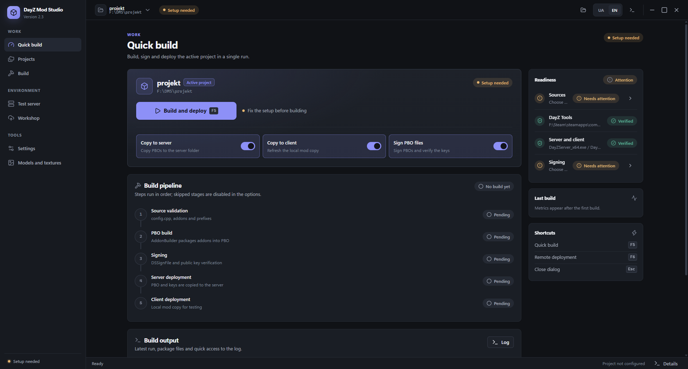

<h1 align="center">DayZ Mod Studio</h1>

<p align="center">Збірка й тестування модів DayZ, перегляд P3D та конвертація моделей і текстур.</p>

<p align="center">
  <a href="https://github.com/Deagles12/dayz-mod-studio/releases/latest">
    
  </a>
</p>



## Встановлення й оновлення

1. Розпакуй portable ZIP в одну папку. Для запуску потрібен Microsoft Edge WebView2 Runtime.
2. Запусти `dayz-mod-studio.exe`. Файл `dayz-backend.exe` має бути в тій самій папці.
3. Для оновлення закрий Studio й скопіюй файли з нового ZIP у папку програми. Збережи папки `projekt`, `output` і `3D-Generator` зі своїми файлами.

## Збірка і тестування мода

1. У майстрі вибери папку вихідних файлів мода. Studio шукає аддони з `config.cpp` і читає `$PBOPREFIX$`. У списку можна змінити папки, назви PBO та префікси.
2. Перевір знайдені шляхи до DayZ Tools, DayZ Server і DayZ. Вибери наявну пару `.biprivatekey` і `.bikey` або створи її в майстрі. Studio зберігає параметри окремо для кожного проєкту.
3. Натисни **Зібрати та встановити (F5)**. Studio збере всі аддони, підпише PBO й встановить перевірені файли в `@Mod\Addons` сервера та клієнта. Публічний ключ потрапить у `Keys` сервера. Перемикачі на головному екрані керують підписом і двома цілями.
4. Для запуску сервера скористайся дією **Зібрати та протестувати** у розділі **Тестовий сервер**. Публікація доступна в розділі **Workshop**, розгортання через SSH/SFTP — на сторінці **Тестовий сервер** або через **F6**.

Перед заміною Studio готує й перевіряє копії для всіх вибраних цілей. Якщо встановлення завершується помилкою, Studio відновлює попередні файли. Ручний відкат доступний у блоці **Резервні копії**.

На сторінці **Тестовий сервер** можна зупинити тестову сесію. Якщо звичайна зупинка не вдалася, кнопка **Примусово завершити власний сервер** завершує сервер, запущений цією копією Studio.

Локальний тест чекає готовності Central Economy (CE) та UDP-порту, а потім перевіряє журнал ще 15 секунд. Помилки VM або пошкоджені збереження переривають тест.

## Моделі й текстури

Ці інструменти доступні без відкритого проєкту. Кнопка **Вибрати папку** змінює місце збереження, а **Відкрити папку** показує результат у Провіднику.

### Перегляд P3D

1. Відкрий розділ **Моделі й текстури** й вибери **3D-моделі**.
2. Натисни **Відкрити P3D**. Після експорту також доступна кнопка **Оглянути P3D**.
3. Обертай, наближай і переміщуй модель. У списку **LOD** можна вибрати окремий рівень деталізації або службовий LOD.

Оглядач відкриває MLOD (P3DM) і бінаризований DayZ ODOL версій 53-56. Ліміт файла - 64 МБ. Для перегляду геометрії без текстур і матеріалів не потрібні Blender і DayZ Tools.

### Експорт GLB у P3D і PAA

- Вибери GLB до 64 МБ з UV і вбудованою PNG-текстурою.
- Studio створює P3D з трьома візуальними LOD, текстуру PAA і звіт `validation.json`. Типова папка результатів - `output\models`.
- Для експорту потрібні Blender і DayZ Tools. Якщо Studio не знаходить Blender, вкажи шлях до `blender.exe` у змінній середовища `DAYZ_BLENDER`.

Звіт містить дані про вершини, трикутники, матеріали та колізію. Перед використанням моделі в грі додай Geometry LOD, Fire Geometry LOD та ігровий конфіг.

### Конвертація текстур

Відкрий **Моделі й текстури** та вибери **Конвертація текстур**. Studio конвертує PNG, JPG, JPEG і TGA в PAA, а PAA в PNG. Потрібен ImageToPAA з DayZ Tools. Типова папка результатів - `output\textures`.

Поруч із програмою є папка `3D-Generator` з інструментами пакетного текстурування готових моделей та файлом `README_UA.md`.

## Команди PowerShell

Запускай команди з папки Studio. На сторінці **Збірка** у блоці **Команди PowerShell** можна скопіювати команди з фактичним шляхом до проєкту й ID збірки.

```powershell
.\dayz-backend.exe --help
.\dayz-backend.exe --project 'D:\Mods\MyMod' status
.\dayz-backend.exe --project 'D:\Mods\MyMod' quick
.\dayz-backend.exe --project 'D:\Mods\MyMod' remote --build-id 20261115-112233-aaaabbbb
.\dayz-backend.exe --recent --json status
.\dayz-backend.exe --recent config --get publish_workshop
.\dayz-backend.exe --recent config --set publish_workshop true --set open_dayz false
```

| Команда | Що робить |
| --- | --- |
| `quick` | Збирає, підписує та встановлює PBO локально, як F5 |
| `update` або `test` | Запускає локальний тестовий цикл |
| `build`, `deploy`, `launch`, `rollback` | Збирає, встановлює, запускає або відкочує локальну збірку |
| `workshop-check`, `publish`, `retry-publish` | Перевіряє сторінку Workshop, публікує або повторює публікацію |
| `remote-check`, `remote --build-id ID` | Перевіряє підключення або розгортає вибрану збірку |
| `status`, `history`, `logs`, `config` | Показує стан, історію, журнали або налаштування |
| `textures` | Конвертує текстури |

- Глобальні параметри `--project`, `--recent`, `--json` і `--verbose` став перед командою.
- `--recent` використовує останній відкритий проєкт. Для `--build-id` скопіюй ID перевіреної збірки зі `status`.
- `--verbose` виводить докладний журнал. Для скриптів використовуй `--json`.

Основний EXE також приймає ці команди через `--cli`.

```powershell
$process = Start-Process -FilePath .\dayz-mod-studio.exe -ArgumentList '--cli --help' -Wait -PassThru -NoNewWindow
$process.ExitCode
```

### Конвертація текстур через CLI

Команда `textures` приймає від 1 до 100 файлів. Можна змішувати PNG, JPG, JPEG, TGA й PAA в одному виклику. Напрямок конвертації залежить від розширення файла.

```powershell
.\dayz-backend.exe textures 'D:\Textures\wall_co.png' 'D:\Textures\wood_co.paa'
.\dayz-backend.exe textures 'D:\Textures\wall_co.png' --output 'D:\Textures\Converted' --tools 'F:\Steam\steamapps\common\DayZ Tools' --open
.\dayz-backend.exe textures --show-output
.\dayz-backend.exe --json textures 'D:\Textures\wall_co.png'
.\dayz-backend.exe --recent textures 'D:\Textures\wall_co.png'
.\dayz-backend.exe textures --help
```

- `--output PATH` вказує наявну папку для збереження. Кожен запуск конвертації створює підпапку з префіксом `export-`.
- `--show-output` показує папку результатів. Використовуй цей параметр без вхідних файлів.
- `--open` відкриває папку в Провіднику. `--tools PATH` задає шлях до DayZ Tools для поточного виклику.
- Без `--project` або `--recent` Studio використовує спільні налаштування та шукає DayZ Tools автоматично.

### Вивід для автоматизації

`--json` виводить по одному JSON-об’єкту на рядок. Поле `event` містить тип події. Для команди `textures` це `progress`, `result` або `error`. У події `result` об’єкт `value` містить `folder`, `files` і `errors`. У текстовому режимі помилки окремих файлів надходять у `stderr`, а обробка решти файлів триває.

Команда `--json textures --show-output` повертає рядок такого вигляду.

```json
{"event":"result","value":{"folder":"D:\\DMC\\output\\textures","files":[],"errors":[]}}
```

| Код завершення `textures` | Значення |
| --- | --- |
| `0` | Команда виконана |
| `1` | Помилка виконання, зокрема часткова помилка конвертації |
| `2` | Помилка синтаксису аргументів |

## AI Agent Integration

У папці `skills/` є окремий набір Agent Skills для Codex, OpenCode, Claude Code, Hermes Agent та інших сумісних хостів. Він навчає агента реальному CLI DayZ Mod Studio, стану проєкту, збірці/підпису, локальному тесту, SSH/SFTP, Workshop, текстурам і моделям, а також правилам безпеки.

- Англійська інструкція: `skills/README.md`
- Українська інструкція: `skills/README_UA.md`
- Версія набору: `skills/VERSION`
- Історія змін: `skills/CHANGELOG.md`

Встановлення у Windows (PowerShell 7+):

~~~powershell
pwsh -NoProfile -File .\skills\install.ps1 -Agents all
pwsh -NoProfile -File .\skills\install.ps1 -Agents all -Scope project -ProjectPath "D:\Mods\MyMod"
~~~

Встановлення на Linux/macOS для хостів агентів:

~~~bash
chmod +x skills/install.sh skills/update.sh skills/uninstall.sh
./skills/install.sh --agents all
~~~

Інсталятор типово створює junction/symlink на єдине джерело, за потреби — копію. Він веде маніфест власності й не видаляє чужі skills. Оновлення — `update.ps1`/`update.sh`, безпечне видалення — `uninstall.ps1`/`uninstall.sh`. Деталі, цільові папки та обмеження описані в `skills/README_UA.md`.

Публікація у Workshop і розгортання на продакшн-сервері потребують явного дозволу. Набір не замінює перевірку геймплею в грі.

## Збірка з вихідного коду

Для Windows-збірки потрібні Node.js з npm, Python, Rust для цілі `x86_64-pc-windows-msvc`, MSVC Build Tools і Windows SDK.

```powershell
npm ci
python -m pip install pyinstaller
npm run desktop
```

Перевірки для розробників.

```powershell
npm run build
python -m unittest discover -s backend -v
cargo test --manifest-path src-tauri/Cargo.toml --locked
```
